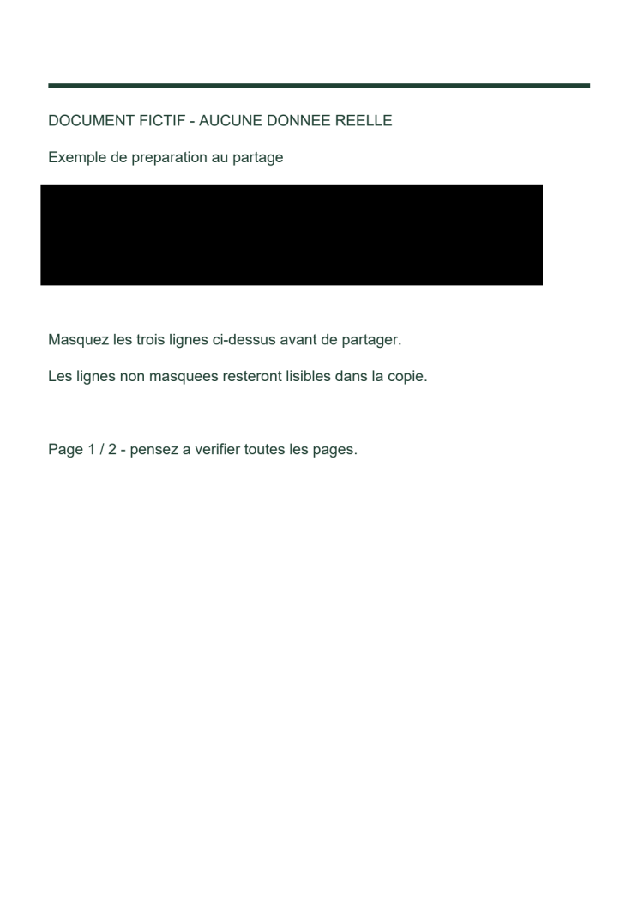

# Partage Clair

**Préparez vos PDF et images avant de les partager. Vos fichiers restent sur votre ordinateur.**

Partage Clair permet de masquer un nom, une adresse ou une référence sur un document,
et de créer une copie sans reprendre ses métadonnées intégrées. Le projet est libre,
sans compte, sans abonnement, sans API et sans télémétrie.

**Version 0.3 : préversion pour des fichiers de confiance.** Aucun audit de
sécurité indépendant n'a encore été réalisé. La détection locale propose des informations
à vérifier ; elle n'est pas exhaustive. Le programme n'est pas un antivirus ni une sandbox.

## Démarrer sur Windows sans Python

Téléchargez le ZIP `PartageClair-0.3.0-windows-x64.zip` depuis les
[versions du projet](https://github.com/Wissko/partage-clair/releases), extrayez-le,
puis lancez `PartageClair.exe`. Le ZIP contient aussi les instructions et les licences
des composants embarqués. Il est destiné à Windows 64 bits. Le binaire n'est pas signé
numériquement ; ne désactivez pas les protections de votre ordinateur pour le lancer.

## Installation depuis les sources

Prérequis : Python 3.11 ou plus, avec Tkinter. Sur Windows, utilisez l'installateur
Python officiel avec Tcl/Tk. Sur Debian/Ubuntu, installez aussi `python3-tk` et `python3-venv`.
Sur macOS, la distribution de python.org inclut Tkinter.

```sh
git clone https://github.com/Wissko/partage-clair.git
cd partage-clair
python -m venv .venv
```

Windows (PowerShell) :

```powershell
.\.venv\Scripts\python.exe -m pip install ".[ocr]"
.\.venv\Scripts\partage-clair-gui.exe
```

macOS / Linux :

```sh
.venv/bin/python -m pip install ".[ocr]"
.venv/bin/partage-clair-gui
```

L'installation télécharge les dépendances. **Le traitement des documents fonctionne
ensuite sans réseau.** macOS et Linux utilisent actuellement cette installation depuis les sources.

1. Ouvrez un PDF ou une image.
2. Lancez **Détecter les informations sensibles**, puis examinez les suggestions.
   Sélectionnez un groupe pour voir ses zones en pointillés, puis validez-le explicitement.
   Sans validation, aucune suggestion n'est masquée. Parcourez **toutes** les pages et
   complétez avec des rectangles manuels.
3. Exportez vers un nouveau fichier. L'original et les fichiers existants ne sont jamais remplacés.
4. Ouvrez la copie exportée et vérifiez chaque page avant de la transmettre.

### Valider un nom sur tout le document

**Valider ce nom partout** applique les zones du nom complet ainsi que du prénom et du nom
séparés sur toutes les pages analysées. La recherche ignore la casse et les accents,
normalise les espaces et certains tirets/apostrophes, et respecte les mots entiers.
Par exemple, valider « Alice Dupont » couvre « ALICE DUPONT », « Alice » et « Dupont »,
mais pas « Dupontel ». Un prénom identique désignant une autre personne sera aussi couvert :
vérifiez les zones proposées avant de valider.

Le champ **Nom oublié par la détection** permet d'ajouter un nom à rechercher partout,
puis de valider ses zones. Une faute OCR ou une autre orthographe n'est pas regroupée
automatiquement : ajoutez-la séparément si nécessaire. Les noms sont proposés par des
libellés et des indices typographiques locaux, pas par un modèle de compréhension universel.

Une validation est groupée : la retirer, l'annuler ou la rétablir agit sur toutes ses zones.
L'export retrouve ces zones dans l'index complet du document, indépendamment de la page
affichée. Il ne reprend que les suggestions validées et les masques manuels. Après une
modification, le bouton d'ouverture de la copie reste désactivé jusqu'à un nouvel export,
pour éviter de confondre une ancienne copie avec l'état actuel.

La détection propose les noms possibles, e-mails, téléphones français, IBAN et cartes
avec contrôle de somme, adresses postales françaises et dates de naissance explicitement
libellées. Elle utilise le texte PDF et un OCR local des pages et images, y compris les
scans. Le portable Windows inclut les modèles OCR ; l'installation `.[ocr]` les obtient
avec les dépendances. Aucun modèle n'est téléchargé pendant le traitement.
Si l'OCR échoue, l'analyse signale sa couverture incomplète. La reconnaissance et les
coordonnées peuvent être imparfaites : élargissez les masques et relisez la copie finale.

Le zoom va de la page adaptée à 400 %, avec barres de défilement et Ctrl + molette.
La liste des pages indique celles déjà consultées et le nombre de masques.
Cliquez un masque pour le sélectionner, puis utilisez Suppr pour le retirer.
Ctrl+Z annule et Ctrl+Y rétablit. Ctrl+O ouvre un fichier, Ctrl+S exporte,
Page précédente / Page suivante parcourent le document.

L'export s'effectue en arrière-plan avec progression et annulation. L'annulation attend
la fin du traitement de la page en cours. Le bouton **Ouvrir la copie** permet de vérifier
le résultat dans votre lecteur habituel. Les masques ne sont pas sauvegardés entre deux
sessions ; l'application avertit avant d'abandonner des modifications non exportées.



Les codes QR, codes-barres, signatures manuscrites, photos et autres identifiants non
reconnus demandent encore un contrôle manuel. Élargissez les masques pour englober entièrement les caractères.
Le nom du fichier peut lui-même être sensible : le nom proposé est `document-a-partager`.

## Ce que l'export fait

| Entrée | Sortie | Transformation |
| --- | --- | --- |
| PDF non chiffré | PDF en images | Les pages sont rendues, les masques noirs sont appliqués aux pixels, un nouveau PDF est créé |
| PNG, JPEG, WebP statique | PNG RGB | L'orientation EXIF est appliquée, la transparence est aplatie sur fond blanc, les pixels sont recopiés sans métadonnées |

Le PDF exporté ne reprend ni couche de texte, ni pièces jointes, ni formulaires,
ni commentaires éditables, ni JavaScript, ni métadonnées Info/XMP du document source.
Les annotations et champs visibles peuvent apparaître dans le rendu : **masquez aussi
leur contenu si nécessaire**. Un rectangle noir est inscrit dans les pixels, pas
simplement placé comme une annotation au-dessus du texte original.

Le PDF perd le texte sélectionnable, la recherche, les liens, les fonctionnalités
accessibles d'un PDF balisé et les signatures numériques. Le fichier peut grossir.
Conservez votre original signé séparément. Le contenu visible non masqué reste récupérable,
y compris par OCR. Le texte invisible ou les métadonnées ne sont pas copiés dans la sortie,
mais des filigranes visuels, des stéganographies ou des indices d'identification dans les
pixels ne sont pas détectés ni systématiquement supprimés.

## Ligne de commande

```sh
partage-clair document.pdf -o document-a-partager.pdf
partage-clair photo.jpg -o image-a-partager.png
partage-clair document.pdf -o document-masque.pdf --masks masques.json --dpi 150
partage-clair document.pdf -o copie.pdf --progress
partage-clair-gui document.pdf
```

Exemple de `masques.json` (données fictives) :

```json
[{"page": 1, "x0": 0.10, "y0": 0.20, "x1": 0.65, "y1": 0.30}]
```

Les pages commencent à 1. Les coordonnées vont de 0 à 1 dans la page **telle qu'affichée**,
avec l'origine en haut à gauche. Sans masque, les métadonnées et objets non rendus ne
sont pas recopiés, mais toutes les informations visibles restent lisibles.

## Limites explicites

- PDF : 50 pages maximum, 100 Mo à l'entrée, 24 millions de pixels par page rendue,
  200 millions de pixels pour l'export total (50 pages A4 à 200 ppp tiennent dans ce budget).
  Résolution de 72 à 200 ppp (150 par défaut).
- Images : 100 Mo à l'entrée, 24 mégapixels maximum. Images animées et multipages refusées.
- PDF chiffrés, documents Office, HEIC et autres formats non pris en charge.
- L'annulation est coopérative entre les pages ; le décodage d'une page ne peut pas être interrompu.
- L'export utilise un fichier temporaire contenant uniquement les pages déjà masquées,
  dans le dossier de destination. Il est supprimé à la fin et en cas d'erreur gérée.
  Un arrêt brutal du système peut laisser ce fichier temporaire sur disque.
- Pas d'effacement sécurisé du disque, de la mémoire virtuelle ou des sauvegardes.
- Pas de conversion de couleur ICC : des couleurs peuvent différer de l'original.
- Ce logiciel n'isole pas les bibliothèques de décodage. N'ouvrez pas un fichier suspect.
- L'OCR traite une page à la fois ; une analyse peut être plus lente que l'export.
  Limites : 500 000 caractères reconnus et 2 000 groupes proposés par analyse.
  Aucun résultat partiel n'est appliqué automatiquement lors d'une annulation.

Pour convertir des documents potentiellement malveillants dans un environnement isolé,
consultez [Dangerzone](https://github.com/freedomofpress/dangerzone). Pour un nettoyage de
métadonnées couvrant davantage de formats, consultez [mat2](https://0xacab.org/jvoisin/mat2).
Partage Clair privilégie ici un parcours simple en français et un masquage manuel explicite.

## Développement

```sh
python -m pip install -e ".[dev,ocr]"
python -m pytest -q
python -m ruff check .
python -m pip_audit -r requirements.txt
python -m pip_audit -r requirements-ocr.txt
```

Les fixtures sont synthétiques. Les tests vérifient les pixels masqués, le contenu
PDF extractible, les objets embarqués, EXIF/XMP, la rotation, les refus d'entrée et
la conservation des originaux. La CI exécute ces contrôles sur Windows et Linux,
avec Python 3.11 et 3.13. Ils ne remplacent pas une revue de sécurité indépendante.

### Performances et application Windows

L'export traite les pages une par une au lieu de garder tous les flux compressés en mémoire.
Les pages exactement grises sont encodées sans changement de pixels sur un seul canal.
Les autres pages gardent leurs couleurs. La compression reste sans perte.
Mesures et protocole reproductible : [BENCHMARKS.md](docs/BENCHMARKS.md).

Pour reconstruire le portable Windows et effectuer son autotest hors ligne :

```sh
python -m pip install -e ".[build,ocr]"
python scripts/build_windows.py
```

Le script vérifie le vrai exécutable construit (PDF, PNG, décodeurs et Tcl/Tk), puis crée
un ZIP avec licences et empreinte SHA-256 dans `dist/`. Le workflow Windows produit
le même type d'archive sur les tags et à la demande.
L'autotest vérifie aussi l'OCR embarqué avec les appels HTTP interdits. Les modèles
RapidOCR/PaddleOCR sont vérifiés par SHA-256 et leurs attributions sont incluses dans
les licences distribuées. Voir [les détails de la détection locale](docs/DETECTION.md).

Architecture : [modèle de confidentialité](docs/PRIVACY.md).
Contribuer : [CONTRIBUTING.md](CONTRIBUTING.md). Licence : [MIT](LICENSE).
Le nom et les visuels de tiers ne sont pas utilisés dans les exemples.

