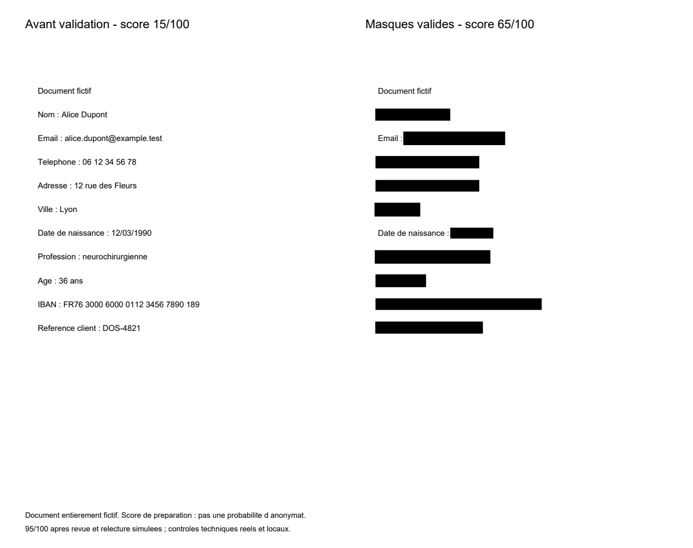

# Démonstration locale : masques, méthodes et score

Exécution du 15 novembre 2026 sur Windows, avec **23 zones sensibles annotées** sur trois
pages entièrement fictives : deux pages PDF avec texte et une page scannée. Noms répétés,
e-mail, téléphone, adresse, ville, naissance, profession, âge, IBAN, références, revenu,
horaire, contexte médical et lien de compte sont représentés. Aucun fichier utilisateur
n'est chargé par le script.



## Évolution mesurée

| Étape | Score de préparation |
| --- | ---: |
| Avant analyse | Indisponible |
| Détection terminée, aucune validation | 15/100 |
| Nom validé sur les trois pages | 21/100 |
| Toutes les suggestions validées pour masquage complet | 65/100 |
| Revue des trois risques déclarée | 69/100 |
| Copie exportée et contrôlée localement | 69/100 |
| Relecture de la copie déclarée | 95/100 |

Le script **simule les décisions et déclarations humaines** pour rendre le calcul
reproductible. Les traitements OCR, exports, contrôles structurels et comparaisons des
pixels sont réellement exécutés. En utilisation normale, les choix restent à valider
dans l'interface ; la relecture doit être réellement effectuée par l'utilisateur.

La détection précédente couvrait 20 des 23 zones connues : deux références non libellées
de façon standard et un organisme avaient nécessité une recherche complémentaire. Les
corrections de la version 0.5 couvrent les **23 zones annotées de cet exemple** sans ajout
manuel. Des confusions entre noms de personnes, noms de rues et références ont aussi été
corrigées. Cela ne constitue **pas** un taux de précision général, une mesure des faux
positifs sur un corpus ou une garantie pour les documents réels.

## Autres méthodes éprouvées sur le même fichier

| Méthode | Ce qui est conservé | Score après contrôle et déclarations |
| --- | --- | ---: |
| Masquage complet | Aucune des valeurs annotées | 95/100 |
| Réduction de précision de l'âge | `36 ans` devient `30-39 ans` | 69/100 |
| Pseudonymisation du nom | Le nom est remplacé par `Personne A` | 69/100 |

Un remplacement est inscrit après retrait des pixels de sa source. Les pixels de son
rectangle sont comparés au remplacement attendu lors du contrôle. Les généralisations
et pseudonymes conservés restent des indices de recoupement : ils ne gagnent pas le
crédit d'un masquage complet et imposent un plafond de 69.

## Reproduire sans réseau pendant le traitement

Après installation des dépendances `.[ocr]`, depuis la racine du dépôt :

```powershell
.\.venv\Scripts\python.exe scripts\demo_anonymisation.py --output tmp\ma-demo-neuve
```

Le dossier doit être neuf ou vide. Le script refuse de remplacer des résultats existants.
Il produit le PDF fictif, trois copies (masquée, généralisée, pseudonymisée), des rendus
PNG, une comparaison et `resultats-demo.json`. Tous ces résultats concernent uniquement
les données synthétiques inscrites dans le script. Les requêtes HTTP et connexions
Python sont bloquées pendant l'exécution.

Les annotations de référence sont obtenues avant rastérisation de la page scannée. La
couverture est comparée aux zones de texte réellement dessinées, sans confondre les
marges de sécurité des rectangles PDF avec des caractères encore visibles. Le script
vérifie que les pixels des 23 zones sont noirs dans la copie entièrement masquée, que
les exports n'ont pas de texte PDF caché et que les valeurs validées ne sont plus
reconnues par la seconde lecture OCR.

Le score ne connaît pas ces annotations de référence : il utilise seulement les contrôles
de l'application. Un score élevé peut donc coexister avec un détail non détecté dans un
autre document. Voir [la méthode et ses limites](ANONYMISATION.md).
